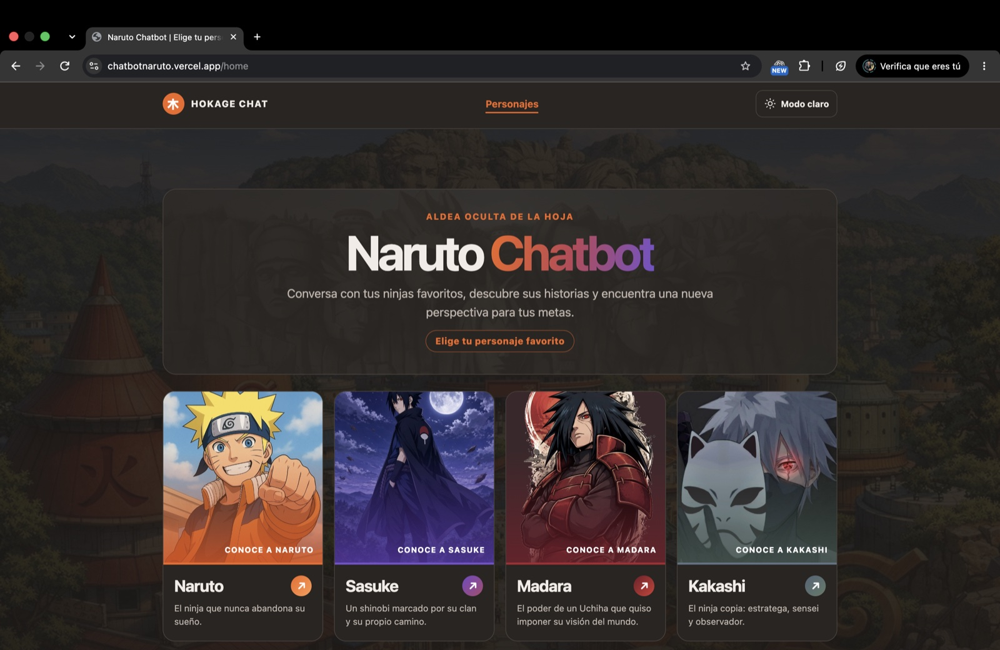
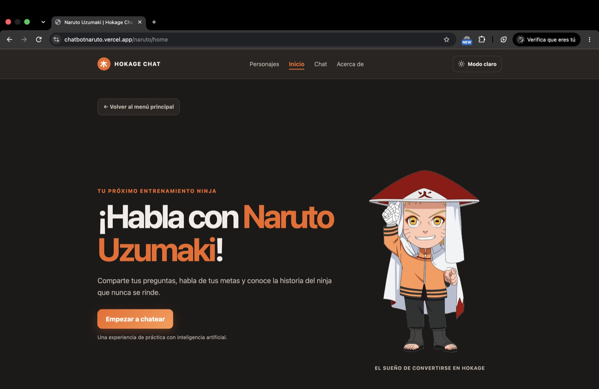
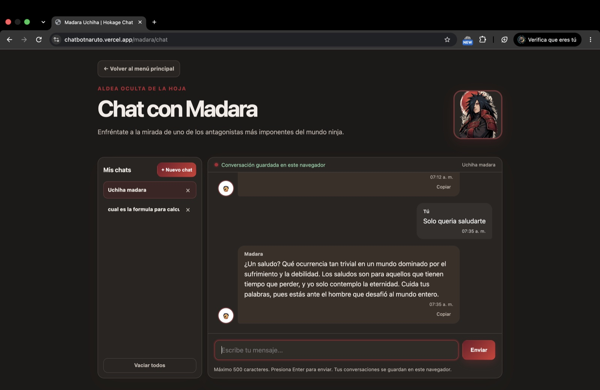
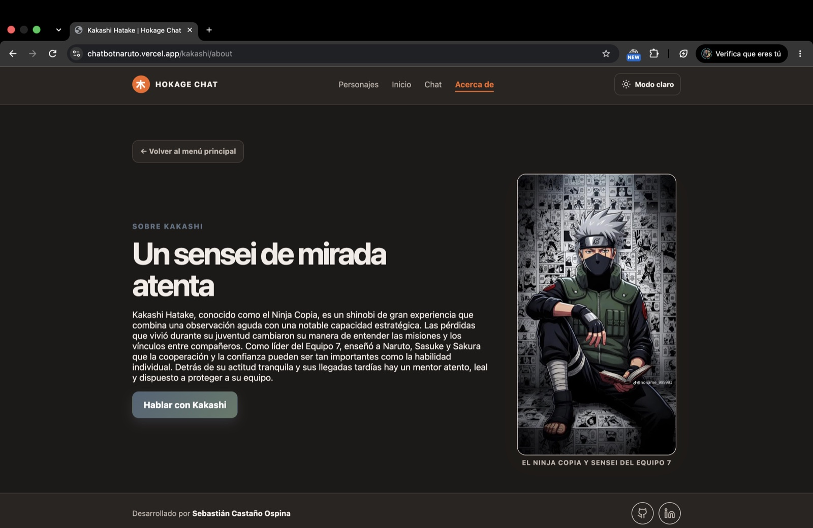
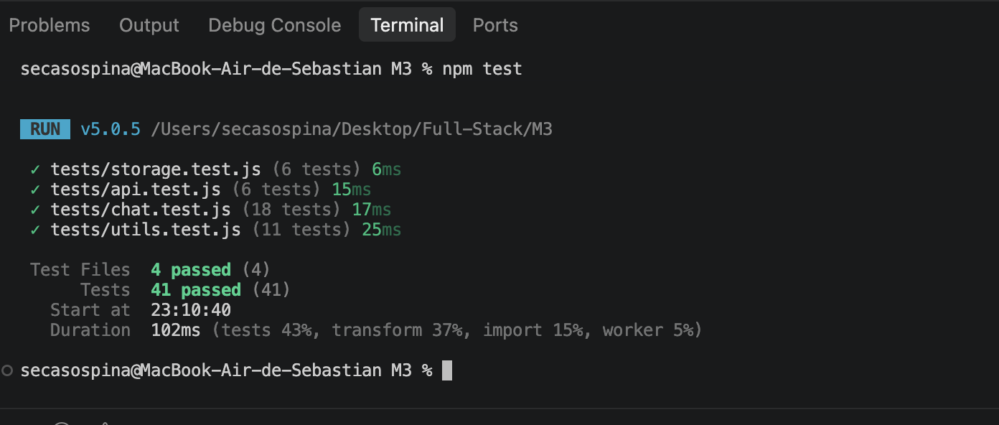

# Hokage Chat

Aplicación web de chat con inteligencia artificial inspirada en cuatro personajes del universo de _Naruto_: Naruto, Sasuke, Madara y Kakashi. Cada uno tiene su propia personalidad, una página de presentación y un historial independiente de conversaciones.

## Índice

- [Enlace a la aplicación](#enlace-a-la-aplicación)
- [Capturas](#capturas)
  - [Galería de personajes](#galería-de-personajes)
  - [Inicio de Naruto](#inicio-de-naruto)
  - [Chat con conversaciones guardadas](#chat-con-conversaciones-guardadas)
  - [Acerca de Kakashi](#acerca-de-kakashi)
- [Personaje elegido](#personaje-elegido)
- [Funcionalidades](#funcionalidades)
- [Tecnologías](#tecnologías)
- [Requisitos](#requisitos)
- [Instalación y ejecución local](#instalación-y-ejecución-local)
- [Pruebas](#pruebas)
- [Despliegue en Vercel](#despliegue-en-vercel)
- [Rutas principales](#rutas-principales)
- [Estructura del proyecto](#estructura-del-proyecto)
- [Decisiones técnicas](#decisiones-técnicas)
- [Almacenamiento y privacidad](#almacenamiento-y-privacidad)
- [Autor](#autor)
- [Documentación: uso de la IA](#documentación-uso-de-la-ia)

## Enlace a la aplicación

[Abrir Hokage Chat](https://chatbotnaruto.vercel.app/home)

## Capturas

### Galería de personajes

[](docs/capturas/galeria-personajes.jpg)

### Inicio de Naruto

[](docs/capturas/inicio-naruto.jpg)

### Chat con conversaciones guardadas

[](docs/capturas/chat-madara.jpg)

### Acerca de Kakashi

[](docs/capturas/acerca-kakashi.jpg)

## Personaje elegido

El proyecto gira alrededor del universo de **Naruto** y ofrece cuatro personajes, cada uno con su personalidad definida mediante un _system prompt_ distinto:

- **Naruto Uzumaki:** optimista, cálido y perseverante. Anima a perseguir las metas y es el personaje principal del proyecto.
- **Sasuke Uchiha:** frío, seco y directo. Responde en una o dos frases, sin entusiasmo.
- **Madara Uchiha:** imponente y teatral. Habla como un antagonista convencido de su superioridad, siempre como ficción y sin instrucciones para la vida real.
- **Kakashi Hatake:** sereno y estratégico. Orienta como un mentor y suele cerrar con una pregunta para reflexionar.

Cada personaje tiene su galería, su página de inicio, su página "Acerca de" y su historial de conversaciones independiente.

## Funcionalidades

- Galería para elegir entre Naruto, Sasuke, Madara y Kakashi.
- Vistas de inicio, chat y acerca de para cada personaje.
- Respuestas de Gemini con un contexto y una personalidad propios por personaje.
- Creación, selección y eliminación de varias conversaciones independientes para cada personaje.
- Persistencia del historial en `localStorage`, incluida la migración del formato anterior.
- Indicador de escritura, hora en cada mensaje, envío con Enter y opción para copiar respuestas.
- Mensajes de error en español cuando falla la conexión o el servidor.
- Modo claro y oscuro con preferencia guardada en el navegador.
- Panel de conversación con altura limitada y scroll interno.
- Diseño mobile-first: parte del celular y se amplía a tableta (700 px) y escritorio (960 px).
- Límite de 500 caracteres por mensaje del usuario; se envían a Gemini hasta los 100 mensajes más recientes de la conversación activa.

## Tecnologías

- HTML semántico, CSS y JavaScript con módulos ES.
- Gemini API para generar respuestas.
- API de Vercel para conectar el navegador con Gemini y mantener la clave fuera del frontend.
- Vercel CLI para el entorno de desarrollo local.
- Vitest para las pruebas del endpoint, del fetching, de las funciones de apoyo y del almacenamiento local.

## Requisitos

- Node.js `22.12+`, `24.x` o `26+`.
- npm.
- Una clave de API de Gemini para usar el chat.

## Instalación y ejecución local

1. Clona el repositorio y entra en la carpeta:

   ```bash
   git clone https://github.com/secasospina/ChatBot_Naruto.git
   cd ChatBot_Naruto
   ```

2. Instala las dependencias:

   ```bash
   npm ci
   ```

3. Crea `.env.local` desde el archivo de ejemplo:

   ```bash
   cp .env.example .env.local
   ```

4. Abre `.env.local` y agrega tu clave de Gemini:

   ```bash
   GEMINI_API_KEY=tu_clave_de_gemini
   ```

   Mantén esta clave privada. No la incluyas en archivos del frontend ni la subas a GitHub.

5. Inicia la aplicación con Vercel:

   ```bash
   npm run vercel:dev
   ```

   Abre en el navegador la dirección local que muestre la terminal, normalmente `http://localhost:3000`.

## Pruebas

Ejecuta las pruebas unitarias con:

```bash
npm test
```

Hay 41 pruebas repartidas en cuatro archivos dentro de `tests/`:

| Archivo           | Qué cubre                                                                                                           |
| ----------------- | ------------------------------------------------------------------------------------------------------------------- |
| `chat.test.js`    | Endpoint `/api/chat`: métodos, clave, validaciones, prompt de cada personaje, errores y tiempo de espera de Gemini. |
| `api.test.js`     | Fetching del frontend: cuerpo de la solicitud, límite de contexto y mensajes de error.                              |
| `utils.test.js`   | Transformación y validación: títulos, limpieza de mensajes, contexto y formato de hora.                             |
| `storage.test.js` | Lectura, migración y guardado del historial con un `localStorage` simulado.                                         |

Las pruebas usan una clave simulada y respuestas controladas; no necesitan una clave real de Gemini.

En la última ejecución pasaron los cuatro archivos y las 41 pruebas:

[](docs/capturas/pruebas.png)

## Despliegue en Vercel

1. Importa el repositorio `secasospina/ChatBot_Naruto` desde GitHub.
2. Mantén `./` como directorio raíz y selecciona el preset `Other`.
3. Agrega `GEMINI_API_KEY` en **Environment Variables** para los entornos que quieras habilitar, como Production y Preview.
4. Despliega el proyecto. Los nuevos cambios enviados a `main` activan despliegues de producción.

No es necesario configurar un comando de build ni una carpeta de salida para esta aplicación. Si cambias una variable de entorno, vuelve a desplegar para que el cambio se aplique.

## Rutas principales

| Sección                | Ruta                |
| ---------------------- | ------------------- |
| Galería                | `/home`             |
| Inicio de un personaje | `/:personaje/home`  |
| Chat de un personaje   | `/:personaje/chat`  |
| Acerca de un personaje | `/:personaje/about` |

En esas rutas, `:personaje` puede ser `naruto`, `sasuke`, `madara` o `kakashi`. Las rutas antiguas `/chat` y `/about` llevan al chat y a la página Acerca de Naruto.

## Estructura del proyecto

```text
├── api/
│   └── chat.js              # Endpoint, validación y prompts de Gemini
├── assets/                  # Imágenes de personajes y fondos
├── docs/
│   ├── capturas/            # Imágenes de referencia para este README
│   └── uso-de-ia.md         # Registro del uso de IA
├── src/
│   ├── app.js               # Rutas (History API), vistas y navegación
│   ├── api.js               # Fetching hacia /api/chat y manejo de errores
│   ├── characters.js        # Datos y contenido de los personajes
│   ├── chat.js              # Interfaz y eventos del chat
│   ├── storage.js           # Lectura y escritura del historial en localStorage
│   ├── utils.js             # Funciones puras de apoyo (transformación y validación)
│   └── styles.css           # Estilos mobile-first
├── tests/
│   ├── chat.test.js         # Pruebas del endpoint (Gemini simulado)
│   ├── api.test.js          # Pruebas del fetching del frontend
│   ├── utils.test.js        # Pruebas de transformación y validación
│   └── storage.test.js      # Pruebas del almacenamiento local
├── .env.example             # Plantilla de variables de entorno
├── index.html               # Documento HTML principal
├── package.json             # Dependencias y comandos
└── vercel.json              # Reescritura de rutas de la aplicación
```

## Decisiones técnicas

- **Contexto de hasta 100 mensajes.** En cada solicitud se envían a Gemini los últimos 100 mensajes de la conversación activa (unos 50 intercambios), que en la práctica es el historial completo de una conversación normal. El tope protege el consumo de tokens y evita solicitudes cada vez más grandes. El historial completo sigue guardado en el navegador (`localStorage`).
- **Límites de tamaño por rol.** Los mensajes que escribe el usuario se limitan a 500 caracteres; las respuestas del personaje admiten hasta 6000 caracteres para que nunca se descarten al recargar.
- **Clave protegida.** `GEMINI_API_KEY` solo existe en el servidor (función serverless de Vercel). El navegador nunca la ve.
- **Rate limiting (límite de uso).** El endpoint `/api/chat` es público y hoy no limita cuántas solicitudes puede hacer una persona. En esta versión se controla con límites de tamaño (máximo 500 caracteres por mensaje del usuario y 100 mensajes por solicitud). Como mejora futura se puede añadir un límite por IP o una herramienta de rate limiting.
- **Mobile-first.** El CSS base está pensado para celular y se amplía con `min-width` en 700 px (tableta) y 960 px (escritorio).
- **Código separado por responsabilidad.** `src/api.js` se encarga del fetching, `src/utils.js` de la transformación y validación, `src/storage.js` de la persistencia y `src/chat.js` del renderizado y la interacción.

## Almacenamiento y privacidad

Las conversaciones y la preferencia de tema se guardan en el `localStorage` del navegador. No se sincronizan entre dispositivos ni navegadores. La clave de Gemini se configura en Vercel o en `.env.local` y se utiliza desde el endpoint del servidor.

## Autor

Desarrollado por **Sebastián Castaño Ospina**.

- [GitHub](https://github.com/secasospina)
- [LinkedIn](https://www.linkedin.com/in/sebastiancastanoo/)

## Documentación: uso de la IA

El proyecto se realizó con apoyo de herramientas de inteligencia artificial para resolver dudas, explorar el diseño visual y colaborar en la implementación. La [documentación del uso de IA](docs/uso-de-ia.md) describe ese apoyo y el uso de Gemini dentro de la aplicación.
