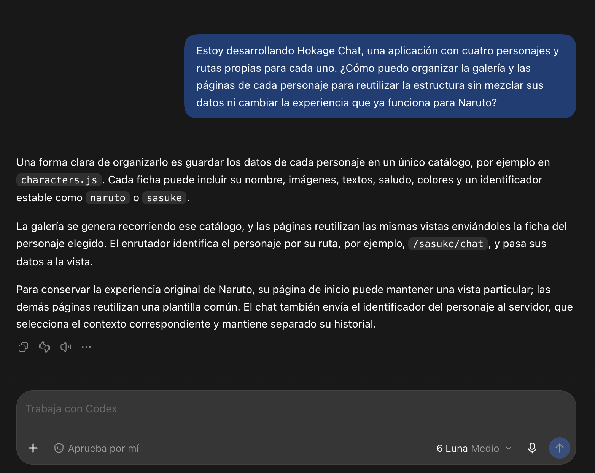
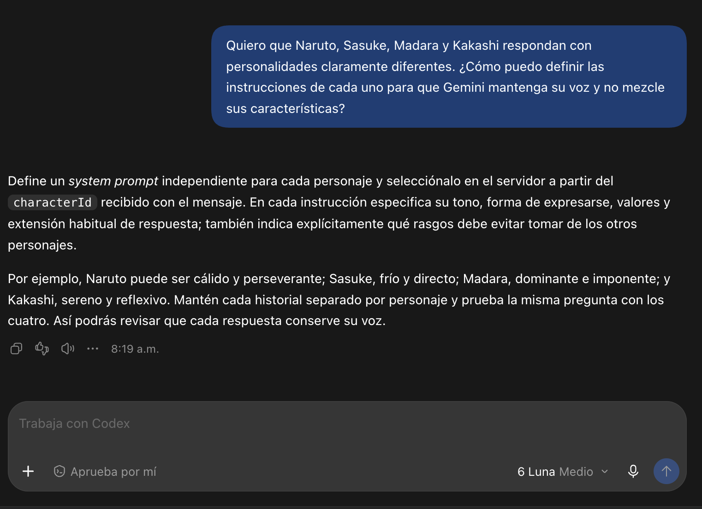
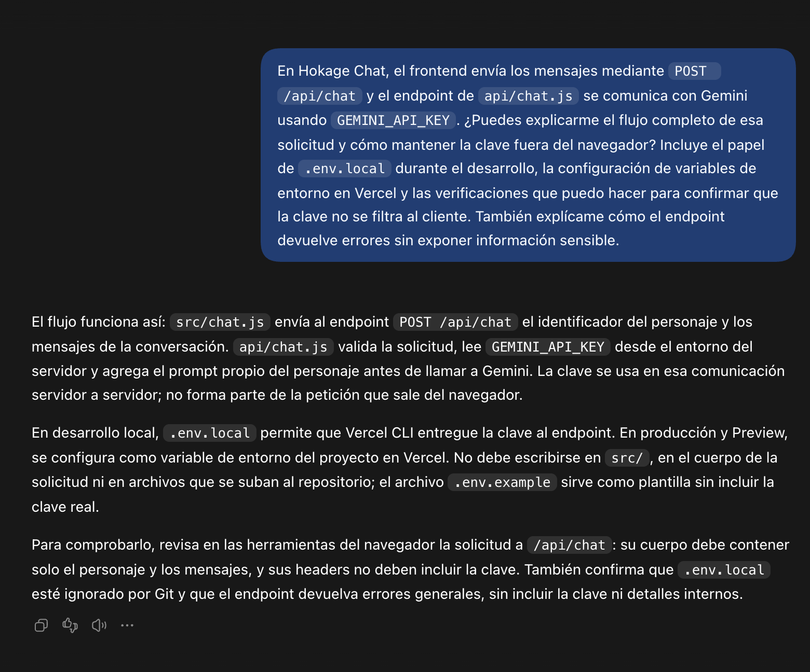
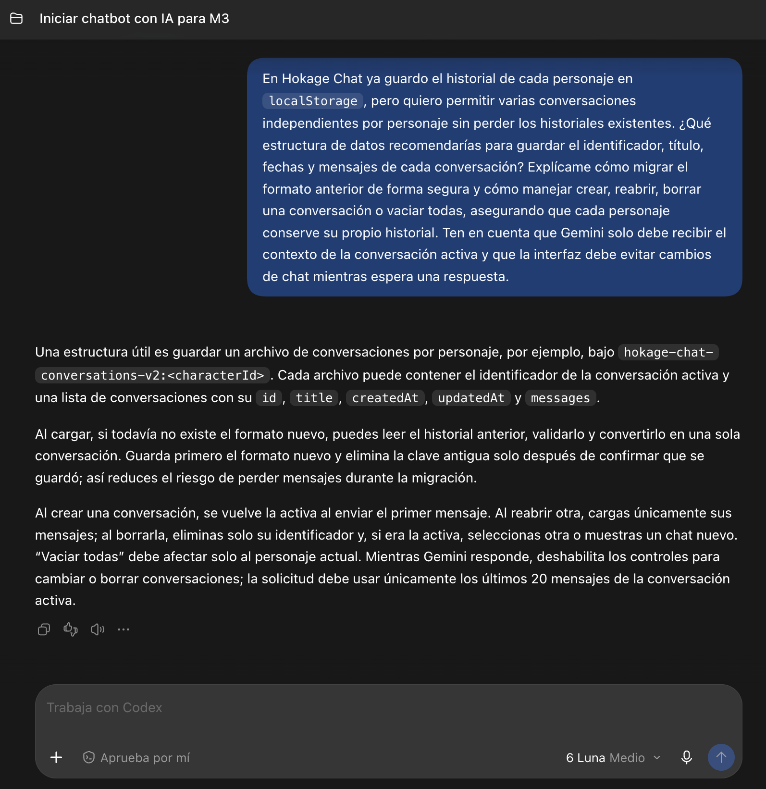
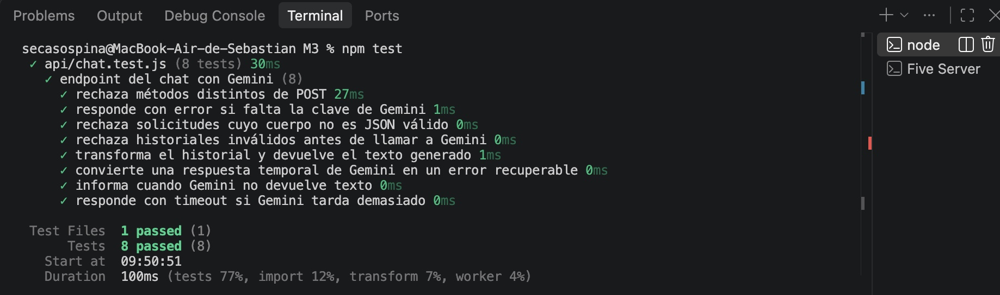

# Documentación del uso de inteligencia artificial

## Apoyo durante el desarrollo

El desarrollo de Hokage Chat se realizó con apoyo de ChatGPT como herramienta de aprendizaje y colaboración. Se utilizó para aclarar dudas sobre el proyecto, explicar conceptos de desarrollo, explorar opciones de estructura y diseño, implementar cambios y resolver problemas encontrados durante el trabajo.

La colaboración fue iterativa: Sebastián definió el objetivo, los personajes, sus personalidades, la dirección visual y los cambios deseados. Revisó las propuestas en la aplicación, señaló ajustes y decidió qué cambios incorporar. ChatGPT ayudó a convertir esas decisiones en modificaciones de interfaz y código; el código propuesto se revisó y se ajustó durante el proceso.

## IA integrada en la aplicación

La aplicación utiliza Gemini API para generar las respuestas del chat. Cada personaje tiene instrucciones propias para conservar una personalidad diferenciada. La solicitud se procesa en `api/chat.js`, y la clave `GEMINI_API_KEY` se configura como variable de entorno del servidor, sin incluirla en el código del navegador.

## Revisión y pruebas

La interfaz se revisó de manera iterativa en las páginas de los personajes y en el chat. El endpoint cuenta con pruebas unitarias ejecutadas con Vitest; estas validan, entre otros casos, las solicitudes, los errores y la respuesta del modelo usando respuestas simuladas.

## Ejemplos de consultas de apoyo

Estas capturas documentan consultas de apoyo sobre decisiones técnicas del proyecto y las respuestas recibidas.

### 1. Organización de personajes y rutas

Consulta sobre cómo reutilizar las vistas para los cuatro personajes y conservar la experiencia original de Naruto.

### 2. Personalidades de Gemini

Consulta sobre cómo definir instrucciones independientes para que cada personaje conserve su propia voz.

### 3. Protección de la clave de Gemini

Consulta sobre el flujo entre el frontend, el endpoint del servidor y Gemini, y sobre cómo verificar que la clave permanezca privada.

### 4. Historial de conversaciones

Consulta sobre el almacenamiento de varias conversaciones por personaje y la migración del historial existente.

## Evidencias del proyecto

Las siguientes capturas muestran el resultado visual de la aplicación y la ejecución de las pruebas:

### Galería de personajes

### Chat con conversaciones guardadas

### Resultado de las pruebas automatizadas

